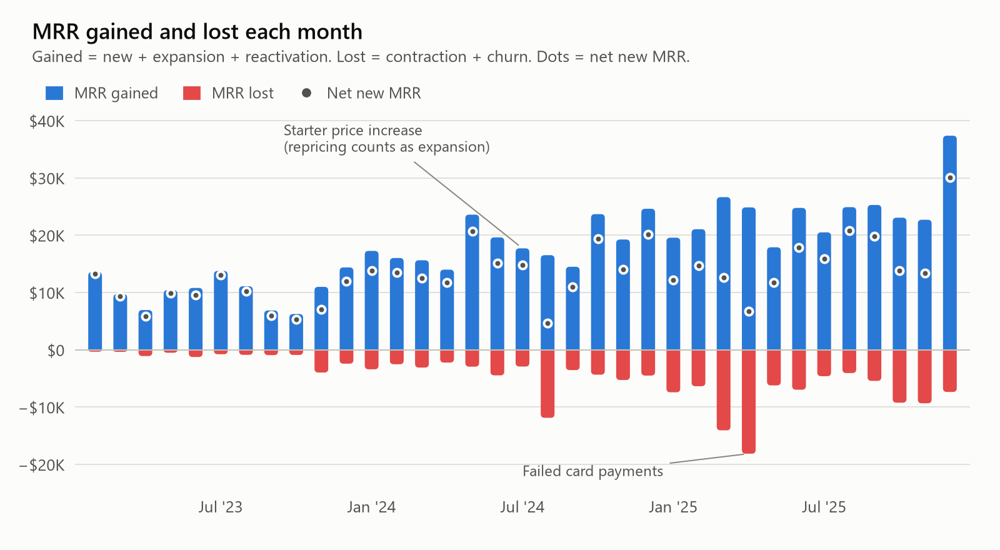
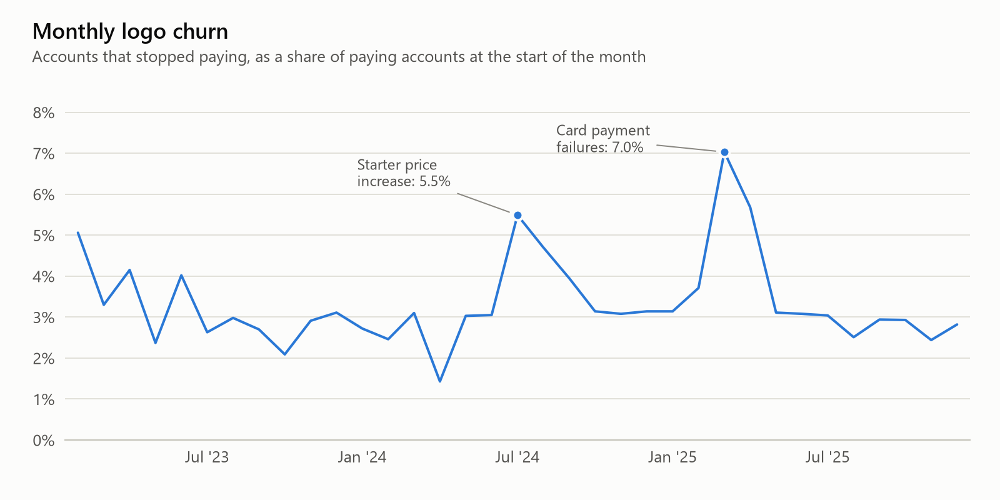
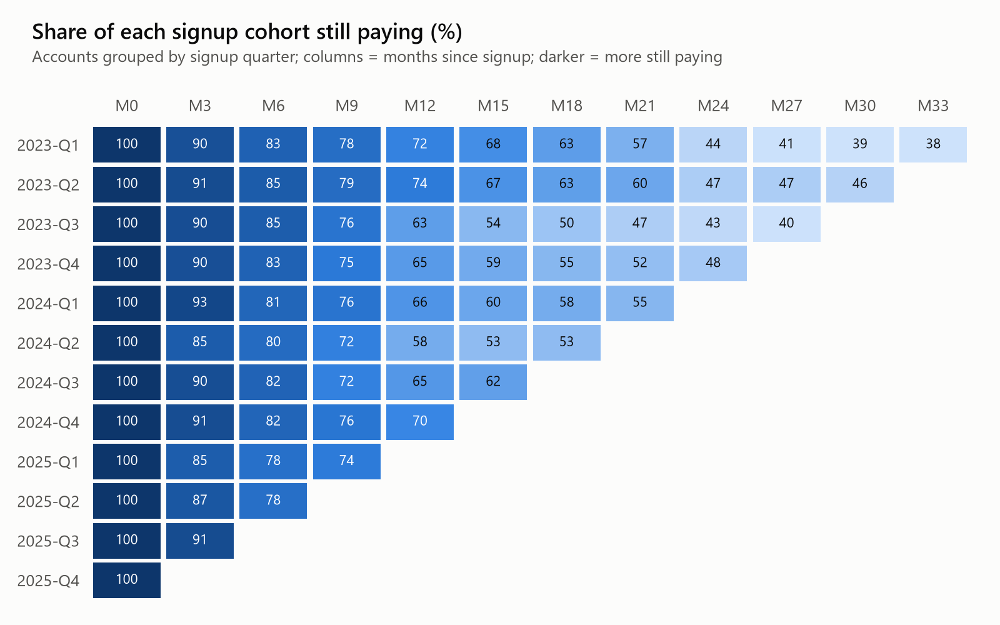
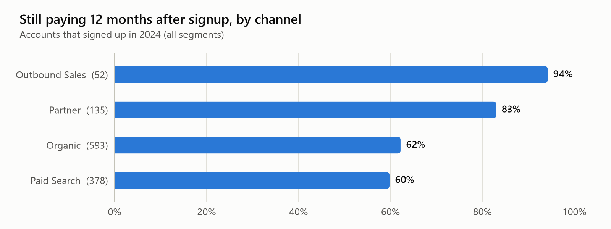

# Subscription Business Dashboard

**SQL (DuckDB) · Python · window functions · cohort analysis · interactive dashboard · Power BI model**

Monthly recurring revenue, retention and churn for a B2B software company over three years, from raw
subscription and invoice records to a dashboard a finance or customer-success team could use.

**[Open the interactive dashboard](https://moonlit-data.github.io/saas-subscription-dashboard/)** (segment
filter, hover details, table view; source: [`docs/index.html`](docs/index.html)).

> **The data is simulated.** Ledgerly is a fictional company: real subscription data is not public.
> `src/generate_data.py` simulates 3,446 customers, 5,525 subscription changes and 28,775 invoices with a
> fixed seed and plants three business events ([docs/data_generation.md](docs/data_generation.md)).
> The analysis finds them from the data alone, and the tests check its numbers against the simulator's
> own log, account by account and month by month.

## Findings

| December 2025 | |
|---|---:|
| MRR | **$476.0K** (+66.3% on December 2024) |
| ARR | $5.71M |
| Paying accounts | 2,212 |
| Average MRR per paying account | $215 |
| Net revenue retention, 12 months | 98.6% |
| Gross revenue retention, 12 months | 77.6% |

1. **The July 2024 Starter price increase paid for itself, just.** Monthly logo churn on Starter jumped
   from 3.6% (January-June) to 11.5% in July, 8.5% in August and 6.3% in September: 78 more accounts
   left than the old rate predicts, taking about $1.9K of MRR. The repricing added $2.8K of MRR, so the
   net effect is **+$0.8K MRR a month**. Growth customers, who were not repriced, show no change.
2. **Failed card payments cost $18.4K of MRR in two months.** In March and April 2025 the share of first
   charges that failed rose from about 2-3% to 7.3% and 6.0%, and retries recovered only 28-30% of them
   (about 80% normally). 108 accounts were lost to non-payment, against about 5 a month the rest of the
   year. This is churn nobody chose, and most of it is recoverable with better retries and reminders.
3. **Partner customers stay longer, even within the same segment.** Of the accounts that signed up in
   2024, 83% of Partner customers still paid 12 months later, against 62% from Organic and 60% from Paid
   Search. Because Partner brings more Mid-Market accounts, the comparison was repeated inside each
   segment: SMB 65% vs 58% (Organic) and 55% (Paid Search); Mid-Market 88% vs 79% and 83%.
4. **Growth depends on Enterprise expansion.** Enterprise retains 117% of its revenue after 12 months,
   Mid-Market 97%, SMB 81%. SMB is 65% of paying accounts but 21% of MRR, and churns 4.5% a month.
5. **Annual billing churns about a quarter as much:** 1.2% a month in 2025 against 5.0% for monthly billing.

<picture>
  <source media="(prefers-color-scheme: dark)" srcset="reports/figures/mrr_gained_lost_dark.png">
  
</picture>

<picture>
  <source media="(prefers-color-scheme: dark)" srcset="reports/figures/logo_churn_dark.png">
  
</picture>

<picture>
  <source media="(prefers-color-scheme: dark)" srcset="reports/figures/cohort_retention_dark.png">
  
</picture>

<picture>
  <source media="(prefers-color-scheme: dark)" srcset="reports/figures/channel_retention_dark.png">
  
</picture>

Numbers behind every chart: [`results/`](results/) (`kpi_monthly.csv`, `cohort_retention.csv`,
`channel_retention_2024.csv`, `price_increase_effect.csv`, `payments_monthly.csv`).

## How it works

| Step | File | What it does |
|---|---|---|
| 1 | [`sql/01_validate_source.sql`](sql/01_validate_source.sql) | Keys are unique, every row has a parent, no account has two subscriptions at once, MRR = seats x price |
| 2 | [`sql/02_account_month.sql`](sql/02_account_month.sql) | Month-end MRR for every account and month (interval join of a month spine with subscription periods) |
| 3 | [`sql/03_mrr_movements.sql`](sql/03_mrr_movements.sql) | Classifies each account-month as new / expansion / contraction / churn / reactivation with `LAG` and a running `MAX` |
| 4 | [`sql/04_monthly_kpis.sql`](sql/04_monthly_kpis.sql) | KPIs for the company and each segment in one pass (`GROUPING SETS`); 12-month NRR and GRR with a self-join |
| 5 | [`sql/05_cohorts.sql`](sql/05_cohorts.sql) | Cohort retention by signup quarter; a month is shown only when the whole cohort has reached it |
| 6 | [`sql/06_segments_and_channels.sql`](sql/06_segments_and_channels.sql) | Segment, channel and billing summaries (one table macro, three uses); same-age channel comparison |
| 7 | [`sql/07_price_increase.sql`](sql/07_price_increase.sql) | Price increase: excess churn vs the pre-increase rate, with Growth as a control group, and the net MRR effect |
| 8 | [`sql/08_payments.sql`](sql/08_payments.sql) | Failed charges, retry recovery, involuntary churn, cash collected vs MRR |
| 9 | [`sql/09_checks.sql`](sql/09_checks.sql) | 17 checks: the MRR bridge closes every month and segment, segments add up to the total, retention bounds |

Python: `src/generate_data.py` (simulation), `src/run_pipeline.py` (loads the CSVs with explicit types,
runs the SQL, exports `results/`), `src/make_charts.py`, `src/build_dashboard.py` (Plotly page with a
segment filter, KPI tiles, hover details and a table view), `src/export_powerbi.py`.

**Power BI:** [`powerbi/`](powerbi/) has the star schema export and the DAX measures, with the expected
totals to check a build against. The `.pbix` report itself is not in the repository yet.

Metric definitions: [docs/metric_definitions.md](docs/metric_definitions.md).

## Tests

`python -m pytest` regenerates the data, runs the pipeline and checks:

- all 17 SQL checks pass;
- the MRR bridge equals the simulator's own event log: every account-month gets the same movement and
  the same dollar change (6,882 events);
- each planted event is found: Starter churn jumps after the price increase while the control group does
  not, the increase still has a positive net effect, involuntary churn in March-April 2025 is more than
  five times the usual level, and Partner retention is higher inside both SMB and Mid-Market.

## Reproduce

```
pip install -r requirements.txt
python src/generate_data.py
python src/run_pipeline.py
python src/make_charts.py
python src/build_dashboard.py
python src/export_powerbi.py
python -m pytest
```

## Limitations

- Simulated data: the findings show what the metrics and checks can detect, not facts about a real company.
- MRR is a month-end snapshot; changes inside a month net out.
- Monthly plan changes are billed from the next invoice (no proration), so cash and MRR differ slightly.
